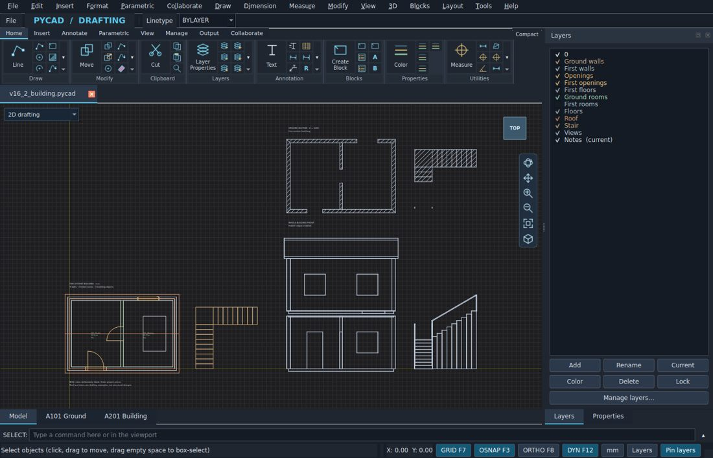

# PY.cad

Free, open-source desktop CAD for 2D drafting, drawing review, and sheet publishing.

**[Download PY.cad](https://github.com/jaykhatri007/py.cad/releases/latest)** · **[Report a bug or suggest a feature](https://github.com/jaykhatri007/py.cad/issues)** · **[See what's new](CHANGELOG.md)**

## Download and try it

Open the [latest release](https://github.com/jaykhatri007/py.cad/releases/latest), expand **Assets**, and choose the installer for your computer:

| Platform | Download |
| --- | --- |
| Windows x64 | Windows `.exe` |
| Ubuntu / Linux x64 | Linux Studio `.run` |
| macOS Intel or Apple silicon | macOS Universal `.zip` |

The release also includes a **Corresponding Source** ZIP and SHA-256 checksums. Windows and macOS packages were built and inspected; feedback from users testing them on those systems is especially welcome.

*Example drafting workspace from an earlier build. The current interface may differ.*

## What you can do

- Draft and edit 2D drawings, including DXF files.
- Organize reusable blocks and place editable parametric doors.
- Review PDF markups and track which items have been resolved.
- Publish a combined PDF from sheets in multiple drawings.

## Help test PY.cad

Try opening a DXF, editing an object, and exporting a PDF. If something goes wrong, [open an issue](https://github.com/jaykhatri007/py.cad/issues/new) with your operating system, PY.cad version, and the steps to reproduce it. Use a non-confidential sample drawing if you attach one. Feature suggestions are welcome, too.

## Source and license

This repository is the source preview. For running from source, see [Ubuntu setup](UBUNTU_START_HERE.txt) and the [development build notes](docs/BUILD-README.md). For the exact source accompanying an installer, use the corresponding source archive attached to that release.

[GPLv3](LICENSE) · [Copyright notices](COPYRIGHT) · [Third-party notices](THIRD_PARTY_NOTICES.md)
